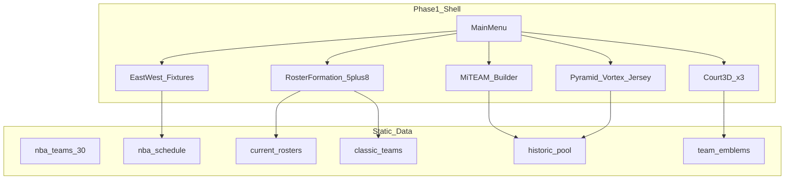

# VORTEX Basketball (VBA) — Phase 1 Implementation Plan

Product: **VORTEX Basketball** in `/Users/admin/Documents/GitHub/VBA`.  
Football product **GOLACO** stays separate at `/Users/admin/Documents/GitHub/GOLACO`.

## Locked decisions

| Decision | Choice |
| --- | --- |
| Codebase strategy | **A — Fork GOLACO into VBA**, then adapt shells and strip football match play |
| Phase 1 scope | Full shell: menus, East/West NBA, teams/emblems/rosters, historic pool, Classic, MiTEAM, Pyramid/Vortex/Jersey, formation 5+8, three 3D courts — **no on-court game** |
| Data | Curated static JSON in-repo + refresh scripts (same pattern as GOLACO `scripts/`) |
| Fixtures season | Current NBA season for League Fixtures; Classic eras are curated packs |
| Street vs Gameplay | Distinct **court environments** from day one; rules/game later |
| Pyramid | Default **Top 100**, user-editable ranking, saved per profile |
| Vortex views | **Triangle**, **5-position ring** (PG/SG/SF/PF/C around #1), **spiral** |
| Branding | **New VORTEX palette/logo** from day one (not GOLACO green/gold) |
| Historic trim | Players with **≥2 NBA seasons** and **≥20 games in each of those seasons** (target 500–1000) |

---

## Architecture overview



Fork GOLACO’s Vite + Three.js + TypeScript stack, then rename the domain layer from football → basketball.

| GOLACO | VBA |
| --- | --- |
| `src/football/` | `src/basketball/` |
| Stadium / pitch | Court environments |
| English leagues | NBA East / West |
| Formation XI + 7 bench | Starting 5 + 8 subs |
| `gameplayMode` REAL/ARCADE/… | BASKETBALL / STREET / MITEAM / PYRAMID |
| `Stadium.ts` | `Court.ts` (+ 3 presets) |

---

## Phase 0 — Bootstrap fork (day 1)

1. Copy GOLACO into VBA (exclude `node_modules`, `dist`, `.git` if any; init new git remote for VBA).
2. Retitle package: `name: "vba"`, description VORTEX Basketball; rewrite `README.md`, `index.html` title, favicons/logo placeholders.
3. Replace CNAME / branding strings (`golaco` → `vortex` / `vba`) in UI chrome.
4. Keep build/test scripts; delete football-only data generators that cannot be reused; keep crest/portrait import patterns.
5. Smoke: `npm install && npm test && npm run dev` with a stripped menu that still boots Three.js.

**Keep (adapt):** `core/` (Game, Loop, SceneManager, SaveManager, Database), `ui/MainMenu`, `ui/CharacterSelect` (reshape), `ui/MiTeamBuilder`, league/fixture panels, Three.js venue layer.

**Strip or stub for Phase 1:** live `Match.ts` gameplay, football physics, FOOSBALL/FLICK/TABLE modes, English league sim. Match flow can end at “Game coming soon” after formation/court select.

---

## Phase 1A — Schema and database

Rewrite [`schema`](../src/data/schema.ts) concepts (after fork paths exist):

- `Conference = "EAST" | "WEST"`
- `PositionCode = "PG" | "SG" | "SF" | "PF" | "C"`
- `TeamType` keep CURRENT / HISTORIC / CUSTOM / LEGENDS patterns
- `VenueType`: `NBA_ARENA` | `STREET_COURT` | `GYM` | `CLASSIC_ARENA`
- Player attributes: basketball set (e.g. finishing, midRange, threePoint, freeThrow, ballHandle, passAccuracy, perimeterD, interiorD, rebound, steal, block, speed, acceleration, vertical, strength, stamina, iq, clutch) — map loosely from old attrs during migrate then delete football names
- Roster slots: `STARTER_PG|SG|SF|PF|C` + `BENCH_1`…`BENCH_8`
- Formation id: fixed `BASKETBALL_5` (position markers on half-court diagram)

Data packs under `public/data/`:

- `nba/teams.json` — 30 franchises, conference, colours, emblem path, home court id  
- `nba/schedule-YYYY.json` — season fixtures with conference tags  
- `nba/results-YYYY.json` — official/sim results merge (mirror GOLACO `officialResults`)  
- `nba/rosters-current.json` — current season squads  
- `nba/players-historic.json` — trimmed historic pool  
- `classic/index.json` + era squads  

Scripts (new, under `scripts/`):

- `generate-nba-teams.mjs` — 30 teams + colours  
- `import-nba-emblems.mjs` — download/normalize PNGs into `public/assets/emblems/`  
- `refresh-nba-schedule.mjs` / `refresh-nba-results.mjs`  
- `refresh-nba-rosters.mjs`  
- `build-historic-pool.mjs` — apply ≥2 seasons × ≥20 GP filter; cap/target 500–1000  
- `generate-classic-nba.mjs` — curated dynasties (e.g. 96 Bulls, 17 Warriors, 86 Celtics, …)

---

## Phase 1B — Menus and settings

Adapt MainMenu panel list:

| Entry | Behaviour Phase 1 |
| --- | --- |
| Gameplay Basketball | Court select → Formation (5+8) → stub match |
| Street | Street court environment → Formation → stub |
| MiTEAM | Pack builder / identity (ported from GOLACO MiTeam) |
| PYRAMID | Pyramid / Vortex / Jersey hub |
| League Fixtures | Tabs: **East** / **West** (standings + date fixtures/results) |
| Classic | Classic team browser → Formation |
| Settings | Re-ordered: display, audio, controls placeholders, league toggle off by default |

`SaveManager` settings:

```ts
gameplayMode: "BASKETBALL" | "STREET" | "MITEAM" | "PYRAMID";
conferenceTab: "EAST" | "WEST";
pyramid: { size: 100; order: string[] }; // player ids rank 1..N
vortexView: "TRIANGLE" | "RING" | "SPIRAL";
jerseySelectNumber: number | null; // 0–99 for JERSEY mode
```

Remove football modes REAL/ARCADE/TABLE/FLICK from VBA settings.

---

## Phase 1C — League Fixtures (East / West)

Port [`LeagueTable.ts`](file:///Users/admin/Documents/GitHub/GOLACO/src/ui/LeagueTable.ts) + fixture panel:

- Division tabs → **EAST** / **WEST** only  
- Standings: W-L, win%, GB, last-10 (compute from results)  
- Fixtures by date with scores when played  
- User club highlight if set  
- No full season sim engine required in Phase 1: show schedule + ingested results; optional “simulate remaining” later  

Wire menu dial “League” to conference, not EnglishLeague enum.

---

## Phase 1D — Teams, emblems, rosters, Classic

1. Seed all 30 NBA teams with primary/secondary colours and emblem assets.  
2. Current roster: ~15–18 players/team with shirt numbers and primary position.  
3. Historic pool: independent of team shell; used by MiTEAM packs + Pyramid.  
4. Classic section: 8–12 curated teams first (expand later), each with era roster + home court id.  
5. Portrait pipeline: reuse GOLACO portrait import pattern where legal/public sources allow; otherwise jersey+number silhouette cards.

---

## Phase 1E — Formation panel (5 + 8)

Fork [`CharacterSelect.ts`](file:///Users/admin/Documents/GitHub/GOLACO/src/ui/CharacterSelect.ts):

- Pitch diagram → **half-court / full-court diagram** with 5 starter slots  
- Bench rail: **8 substitutes**  
- Modes: PLAYER SELECT / TEAM SELECT / KIT SELECT / MITEAM (when MiTeam side)  
- Drop football chalk/play-style that does not apply; keep side HOME/AWAY if dual formation remains useful  
- Kit preview: jersey name + number (front/back panels simplified for basketball)

---

## Phase 1F — MiTEAM

Port MiTeam builder:

- Pack open / keep / discard UX retained  
- Pool filters: All / East / West / Classic era / position  
- Identity panel (name, emblem, colours, reset) already redesigned in GOLACO — copy that layout  
- Cards show origin franchise until identity customized  

---

## Phase 1G — PYRAMID, Vortex, Jersey

New UI module `src/ui/Pyramid.ts` (+ CSS):

1. **Pyramid** — rows for ranks 100→1 (or collapsible bands); drag or ↑↓ to reorder; persist `save.data.pyramid.order`.  
2. **Vortex Triangle** — same 100 ordered as triangular layout (1 at apex).  
3. **Vortex Ring** — center = rank 1; five wedges PG/SG/SF/PF/C with that position’s ranked players around.  
4. **Vortex Spiral** — 100→1 along Archimedean spiral.  
5. **Jersey** — pick jersey number 0–99; list Pyramid-eligible players who wore that number (historic + current); select into focus / compare.

Default seed order: curated Top 100 overall rating from historic+current pool (editable).

Card chrome: **name + number kit design** (no full portrait required for Pyramid v1).

---

## Phase 1H — Three 3D court environments

Replace stadium system with `src/basketball/court/Court.ts`:

| Id | Name | Used by |
| --- | --- | --- |
| `nba_arena` | Pro arena (hardwood, hoops, boards, seating bowl) | Gameplay Basketball, Classic |
| `street_court` | Outdoor asphalt / chain net / fence / city block | Street |
| `gym_court` | Indoor high-school/college gym | Fallback / practice / MiTEAM backdrop |

Menu attract / pre-match: orbit camera over selected court (same role as GOLACO menu stadium).  
No ball physics or players on court in Phase 1 — environment art + lighting only.

---

## Phase 1I — Branding and chrome

- Logo mark **VORTEX** + basketball motif  
- CSS variables: deep court black/navy, maple hardwood accent, electric accent (avoid GOLACO purple/cream AI defaults and avoid copying GOLACO green/gold)  
- Main menu reorder to Basketball / Street / MiTEAM / Pyramid first  
- Settings panels reordered for basketball (no football-specific toggles)

---

## Execution order (recommended)

1. **P0** Fork + boot + branding stub  
2. **1A** Schema + empty NBA data stubs (30 teams)  
3. **1B** Menu modes + settings enums  
4. **1H** Court environments (so menu has a 3D home)  
5. **1C** East/West fixtures UI with stub schedule  
6. **1D** Emblems + current rosters + Classic seed  
7. **1E** Formation 5+8  
8. **1F** MiTEAM  
9. **1G** Pyramid / Vortex / Jersey  
10. **1A scripts** Historic pool build to 500–1000  
11. Polish, tests, README play instructions  

---

## Testing

- Vitest: conference standings math, historic filter, pyramid reorder persistence, roster slot validation (exactly 5 starters + ≤8 bench).  
- Manual: menu navigation, fixture East/West, formation drag, Pyramid drag, court switch Street vs Arena.  

---

## Out of scope (later)

- On-court gameplay, AI, rules, shot timing  
- Full season franchise career / trade engine  
- Licensed likeness claims (use gameplay ratings + public roster data only; same disclaimer pattern as GOLACO)  
- Multiplayer / online  

---

## First implementation command (when building starts)

```bash
# From a machine with both folders:
rsync -a --exclude node_modules --exclude dist --exclude .git \
  /Users/admin/Documents/GitHub/GOLACO/ /Users/admin/Documents/GitHub/VBA/
cd /Users/admin/Documents/GitHub/VBA
git init
# then rename package, strip match play, begin Phase 1A
```
